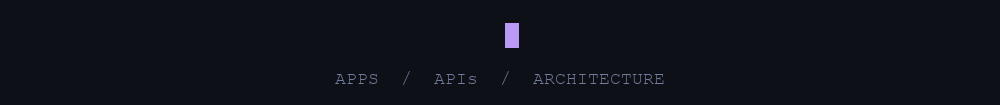
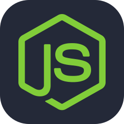
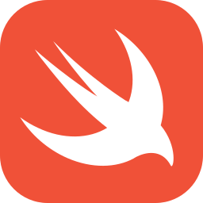
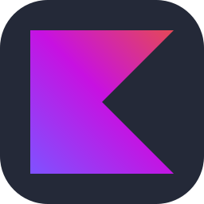
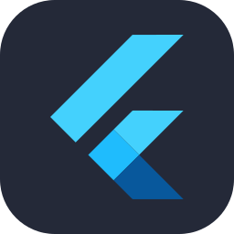
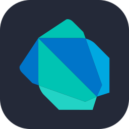
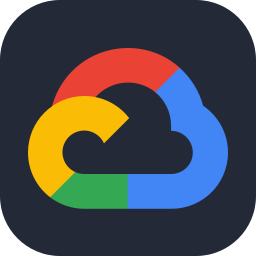
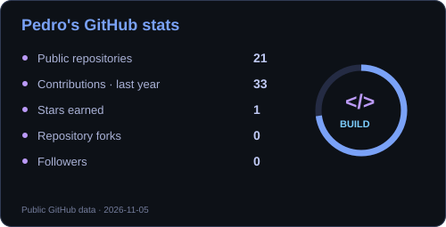
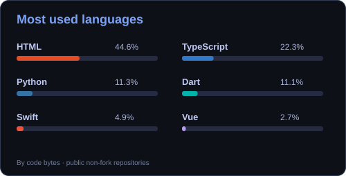
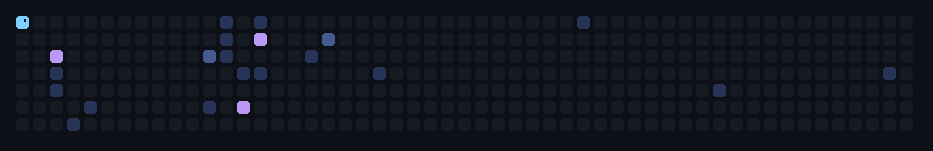

<h1 align="center">Hey, I'm Pedro Santilli 👋</h1>

<p align="center">
  
</p>

<p align="center">
  <a href="https://www.linkedin.com/in/pedro-santilli-de-souza/"></a>
  &nbsp;
  <a href="mailto:psantillidesouza@gmail.com"></a>
  &nbsp;
  <a href="https://github.com/Pedro-Santilli?tab=repositories"></a>
</p>

<br />

### 🧑‍💻 A little about me

- 🏗️ At **Invictus AdCompany**, I supervise app development and design application architectures.
- 📱 I build for **iOS, Android and the web**, connecting interfaces to APIs and cloud services.
- ⚙️ My work includes **microservices, asynchronous messaging, authentication and subscriptions**.
- 🎓 Computer Science at **UNIMAR** · expected completion in 2026.
- 📍 Based in **Marília, Brazil**.

```typescript
const pedro = {
  role: "Full Stack & Mobile Developer",
  focus: ["App architecture", "Backend services", "Mobile products"],
  mobile: ["Swift", "SwiftUI", "Kotlin", "Flutter"],
  backend: ["TypeScript", "Node.js", "Bun", "Python", "Go"],
  building: ["Apps", "APIs", "Integrations"]
};
```

<br />

<h2 align="center">⚡ My stack</h2>

<p align="center"><b>Languages & backend</b></p>
<p align="center">
   &nbsp;
   &nbsp;
   &nbsp;
   &nbsp;
   &nbsp;
  
</p>

<p align="center"><b>Mobile & web</b></p>
<p align="center">
   &nbsp;
   &nbsp;
   &nbsp;
   &nbsp;
   &nbsp;
  
</p>

<p align="center"><b>Data, cloud & tools</b></p>
<p align="center">
   &nbsp;
   &nbsp;
   &nbsp;
   &nbsp;
   &nbsp;
  
</p>

<br />

<h2 align="center">📊 GitHub stats</h2>

<p align="center">
  <a href="https://github.com/Pedro-Santilli">
    
    
  </a>
</p>

<p align="center"><sub>Public GitHub activity. Language percentages reflect repository code, not proficiency.</sub></p>

<br />

### 🚀 Things I've built

| Project | What it does | Main technologies |
| :--- | :--- | :--- |
| **Sintony** | Dating app with native clients and recommendation services | Swift, Kotlin, Node.js, PostgreSQL, Pub/Sub |
| **StitchMind** | Video lessons, project tools and an AI assistant | Flutter, Firebase, RevenueCat, Bun |
| **KingChat** | Multi-tenant messaging and chatbot automation | Fastify, RabbitMQ, Redis, WebSocket |
| **Dolarizado** | Courses, live sessions and certificates | Flutter, NestJS, PostgreSQL |
| **Orbit** | Campaign management and Apple Ads reports | Next.js, React, TypeScript |
| **$herlock** | Personal finance app published on the App Store | Swift, SwiftUI, CloudKit |

<br />

<h2 align="center">🐍 My contributions, one bite at a time</h2>

<p align="center">
  
</p>

<p align="center"><sub>Built from my GitHub contribution calendar · updated with GitHub Actions</sub></p>

<br />

<p align="center">
  <b>Apps, APIs or architecture? Let's talk.</b><br /><br />
  <a href="https://www.linkedin.com/in/pedro-santilli-de-souza/">LinkedIn ↗</a> &nbsp; · &nbsp;
  <a href="mailto:psantillidesouza@gmail.com">Email ↗</a>
</p>
